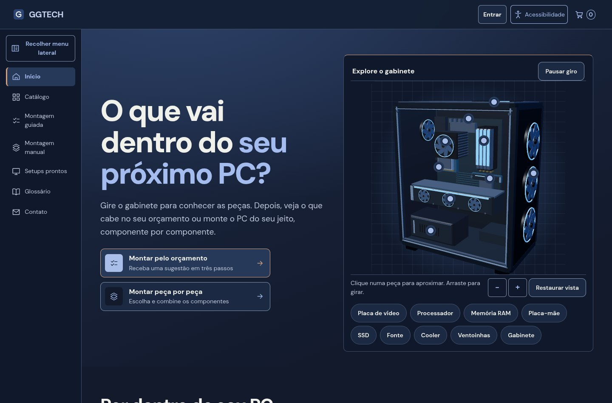

# GGTECH

[Português](README.md) · **English**

**Gabriel Guimarães · Interface Development · UniCEUB, 2026**

I made GGTECH to help people build their first PC. You can explore a 3D PC case, learn what each part does, compare prices, and check whether parts work together. The website and the linked project notes are in Portuguese.

## Open either version

- **First submission.** It has a 3D PC case with four groups of parts, 20 sample products, a theme switch, and a slideshow. This copy comes from commit `5615947`, which includes fixes for contrast, keyboard focus, and the tab icon. [Open the first version](https://gabrielguimaraes07.github.io/Trabalho_final_di/entrega-parcial/) · [First version files](entrega-parcial/)
- **Final version.** It has 62 real products in 19 categories, 16 ready-made builds, a guided and a manual builder, part comparisons, a guide, a glossary, a cart, and accessibility settings. [Open the final site](https://gabrielguimaraes07.github.io/Trabalho_final_di/entrega-final/) · [Final files](entrega-final/)



[Product catalog](entrega-final/docs/capturas/apresentacao-catalogo.jpg) · [Guided builder](entrega-final/docs/capturas/apresentacao-montador.jpg) · [Manual builder](entrega-final/docs/capturas/apresentacao-simulador.jpg) · [Mobile home page](entrega-final/docs/capturas/apresentacao-celular.jpg) · [Accessibility settings](entrega-final/docs/capturas/apresentacao-acessibilidade.jpg)

## How the site came together

### 1. The first page

I started with a header, menu, main content, and footer in HTML. The **Pular para o conteúdo** (Skip to content) link helps keyboard users reach the main content. I kept colors, text sizes, and spacing in one CSS file so the other pages could use the same style. [Color palette](entrega-final/docs/paleta.md) · [Color psychology](entrega-final/docs/psicologia-cores.md)

### 2. The 3D PC case

The case was built with Three.js. You can rotate it and click a part to see products in that category. The buttons below the model give keyboard users the same options. When 3D is unavailable, the site shows an image of the case. The final version also has an exploded view that pulls the parts apart to show where each one goes.

### 3. The first examples

I added simple explanations of what the parts do. RAM, for example, works like a desk where you keep the things you are using. Codex helped me arrange the carousel images and set up the arrows, slide indicators, and pause button. I also fixed controls that were hidden behind the menu when using Tab. [Review of the first submission](entrega-final/docs/revisao-parcial.md)

### 4. The menu, login, and reading options

In the final version, the menu links to the catalog, builders, ready-made builds, glossary, and contact page. On a phone, you can open and close the menu with a button. Codex helped me set up the **Sign in** and **Create account** tabs and the feedback messages for the demo login.

Codex also helped me build the accessibility panel. You can choose a light or dark theme, make the text bigger, change the spacing, increase contrast, and underline links. A preview shows the changes right away, and the browser saves your choices. The reduced-motion setting pauses the 3D case rotation and automatic carousel slides. [Interface choices](entrega-final/docs/ihc-ux-ui.md)

### 5. Real products

I replaced the sample products with real models. Each part has a photo, brand, model name, reference price, and specs. The catalog, guide, cart, and saved builds all use the same product ID. The photos are in the project files. [Product data](entrega-final/dados/produtos.json)

### 6. Search and comparisons

In the catalog, you can choose a category from the tabs and search by name. Under **Armazenamento** (Storage), for example, the **Tipo de peça** (Part type) filter lets you choose between SATA SSDs, NVMe SSDs, and hard drives. You can also filter by brand, price, or compatibility. **Detalhes da peça** (Part details) opens the full specs. The comparison shows up to three models of the same type side by side, so you can see which processors have built-in graphics, for example. [Nielsen's usability principles in GGTECH](entrega-final/docs/heuristicas-nielsen.md)

### 7. Two ways to build a PC

In the **guided builder**, you choose what you will use the PC for, set a budget, and pick a priority from savings, performance, or RGB lighting. If the budget is too low, the site shows the lowest price for that use. The result groups PC parts and accessories separately.

In the **manual builder**, you can start from scratch or edit a ready-made build. The list, total price, and warnings update as you pick parts. You can save the build, share it with a link, or print it.

### 8. Compatibility checks and the cart

The site checks whether the parts fit and have enough space, power, and connections. In the MSI MAG PANO M100R PZ case, for example, SATA SSDs and hard drives share a mounting space. The builder warns you if you pick too many.

In the cart, you can check the items, quantities, and total before confirming a mock purchase. On a phone, the bar with the total takes you straight to the build summary.

### 9. Testing

Testing covered keyboard navigation, large and small screens, text at 200%, and color contrast. It also covered part comparisons, the cart, and opening and saving builds. [Project tests](entrega-final/docs/auditoria.md) · [Adobe Color contrast results](entrega-final/docs/contraste-adobe.md) · [How I used AI](entrega-final/docs/registro-ia.md)

## An example for the presentation

1. Open **Montagem guiada** (Guided builder) and choose **Estudar** (Study).
2. Enter 4000 to see the budget warning. Then raise the budget to 8500. Prices are in Brazilian reais.
3. Check the subtotals and select **Personalizar na montagem manual** (Customize in the manual builder) to swap the case or headset.
4. Check the new total and warnings. Move the parts to the cart and review the items before confirming the mock purchase.

## Run the site on your computer

In VS Code, open the `index.html` file for the version you want and choose **Open with Live Server**. If you prefer Python, open a terminal in the main project folder and run this command.

```sh
python -m http.server 8765
```

Then open [the first version](http://localhost:8765/entrega-parcial/) or [the final version](http://localhost:8765/entrega-final/). The local server helps the browser load the data and JavaScript files. The first version loads Three.js over the internet. The final version includes it in the project files.

## Where to find the code

- **HTML.** `index.html` is the home page, `estoque.html` is the catalog, and `simulador.html` is the manual builder.
- **CSS.** `css/` holds the styles. `tokens.css` has the color palette and `layout.css` sets up the menu and footer.
- **JavaScript.** In `js/`, `principal.js` starts each page's features and `compatibilidade.js` checks which parts work together.
- **Data.** `dados/` holds the products, ready-made builds, and glossary.
- **Images and libraries.** These are in `recursos/`. Three.js draws the case, and GSAP handles animations like pulling the parts apart. [Code guide](entrega-final/docs/codigo.md)

## Demo limits

Prices are for reference, in Brazilian reais, and exclude shipping. Some come from offers that have ended. The builder uses the dimensions and connections listed in the catalog. When assembling a real PC, you still need to check details like the BIOS version, room for cables, and radiator placement. Sign-in, contact, and checkout are simulated. The cart, preferences, and saved builds stay in the browser you use. [Photo credits and references](entrega-final/docs/referencias.md)
