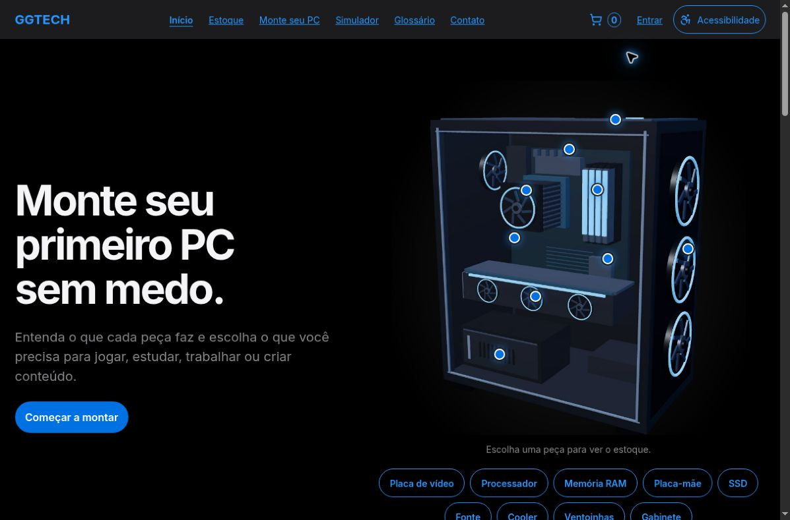

# GGTECH

Um site para quem quer montar o primeiro PC e ainda está aprendendo o que cada peça faz. Comece pelo gabinete 3D, escolha uma configuração pronta ou monte a sua. O site soma os valores e avisa se houver problemas como um processador com socket diferente do da placa-mãe.

**Gabriel Guimarães · Desenvolvimento de Interfaces · UniCEUB, 2026**

[Abrir o GGTECH](https://gabrielguimaraes07.github.io/Trabalho_final_di/)



## O que vale experimentar

- **Explore o gabinete.** As peças abrem o catálogo da categoria. Também dá para chegar às mesmas opções pelos botões abaixo do 3D.
- **Compare peças.** O catálogo tem 56 produtos em 19 categorias. A comparação coloca até três modelos do mesmo tipo lado a lado.
- **Monte um PC.** O montador guiado sugere peças a partir do uso e do orçamento. Na montagem manual, dá para trocar itens de um dos 16 setups, salvar o resultado ou compartilhar por link.
- **Ajuste a leitura.** O painel de acessibilidade deixa mudar o tema, o tamanho do texto, o contraste e o movimento. As preferências ficam salvas no navegador.

## Como rodar no seu computador

Baixe ou clone o repositório. No VS Code, abra `index.html` com a extensão **Live Server**. Também dá para iniciar o servidor pelo terminal, na pasta do projeto.

```sh
python -m http.server 8765
```

Em seguida, abra [localhost:8765](http://localhost:8765/). As páginas usam HTML, CSS e JavaScript, com Three.js para o gabinete e GSAP nas animações. Os arquivos em `data/` alimentam o catálogo e os setups.

## Por trás do projeto

- [Decisões de interface e capturas](docs/design-site.md) · [Heurísticas de Nielsen](docs/heuristicas-nielsen.md)
- [Testes técnicos](docs/auditoria.md) · [Paleta e contraste](docs/paleta.md)
- [Arquivos do projeto](docs/codigo.md) · [Referências e cotações](docs/referencias.md) · [Como a IA ajudou](docs/registro-ia.md)

Compra e login são simulações. Os preços foram consultados em 23/11/2026 e servem de referência, sem frete. O rótulo **Preço histórico** indica que a oferta já estava indisponível na consulta.
