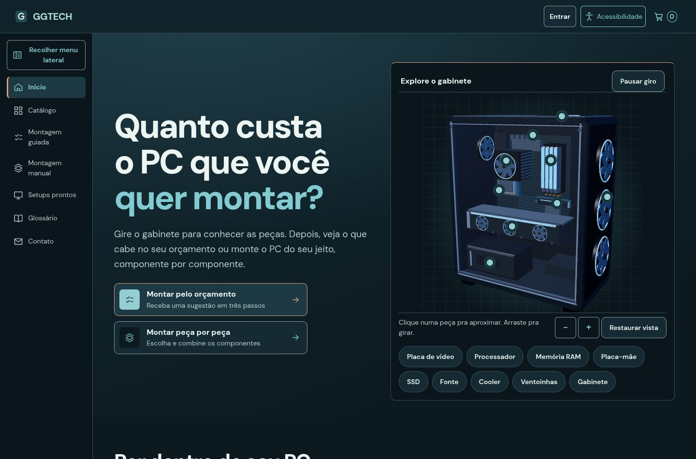

# GGTECH

**Português** · [English](README.en.md)

**Gabriel Guimarães · Desenvolvimento de Interfaces · UniCEUB, 2026**

Fiz o GGTECH para ajudar quem quer montar o primeiro PC. Dá para olhar as peças dentro de um gabinete em 3D, entender o que cada uma faz e experimentar uma configuração antes de pensar em comprar. Quem ainda não sabe por onde começar pode usar a montagem guiada. Quem já tem algumas peças em mente pode ir direto ao catálogo ou à montagem manual.

## Abra as duas entregas

- **Parcial.** Tem o gabinete 3D com quatro grupos de peças, 20 produtos de exemplo, troca de tema e carrossel. [Abrir a parcial](https://gabrielguimaraes07.github.io/Trabalho_final_di/entrega-parcial/) · [Arquivos da parcial](entrega-parcial/)
- **Final.** Tem 62 produtos reais em 19 categorias, 16 setups prontos, montagem guiada e manual, comparação de peças, guia, glossário, carrinho e painel de acessibilidade. [Abrir a final](https://gabrielguimaraes07.github.io/Trabalho_final_di/entrega-final/) · [Arquivos da final](entrega-final/)



[Gabinete](entrega-final/docs/capturas/apresentacao-gabinete.jpg) · [Glossário](entrega-final/docs/capturas/apresentacao-glossario.jpg) · [Catálogo](entrega-final/docs/capturas/apresentacao-catalogo.jpg) · [Montagem guiada](entrega-final/docs/capturas/apresentacao-montador.jpg) · [Montagem manual](entrega-final/docs/capturas/apresentacao-simulador.jpg) · [Início no celular](entrega-final/docs/capturas/apresentacao-celular.jpg) · [Painel de acessibilidade](entrega-final/docs/capturas/apresentacao-acessibilidade.jpg)

## Como o site foi construído

### 1. A primeira página

Comecei pelo `index.html`, com cabeçalho, menu, conteúdo e rodapé. Na parte de cima, deixei dois caminhos para montar o PC e coloquei o gabinete 3D ao lado. Mais abaixo ficaram os cartões das peças, o carrossel e os setups prontos. O link **Pular para o conteúdo** leva quem usa o teclado direto à parte principal.

Separei os estilos em CSS puro. Em `tokens.css` ficam as cores dos dois temas, os tamanhos de letra e os espaçamentos. Assim, um botão usa as mesmas cores na página inicial e no catálogo. Usei a fonte DM Sans, que vem no próprio projeto, e um degradê azul-petróleo no tema escuro, com azul mineral nos controles e detalhes em latão. O G claro no quadrado azul-petróleo identifica a marca no cabeçalho e na aba do navegador. A estrutura das páginas fica em `layout.css`, e a navegação lateral em `navegacao.css`. [Paleta](entrega-final/docs/paleta.md) · [Psicologia das cores](entrega-final/docs/psicologia-cores.md)

### 2. O gabinete em 3D

O `modelo-pc.js` monta o gabinete e as peças com formas e materiais do Three.js. No `cena3d.js`, o clique identifica qual peça foi selecionada e leva a câmera até ela. A aproximação desacelera perto da peça. Quando termina, o catálogo abre à direita no computador e embaixo no celular. Ali aparecem as fotos, os preços e o atalho para usar a peça na montagem manual.

Dá para girar o gabinete com mouse, toque ou setas do teclado. O giro automático pausa durante o uso e volta depois de alguns segundos sem interação. O botão **Pausar giro** mantém o modelo parado até escolher **Retomar giro**. Os botões de zoom e **Restaurar vista** ajudam a retomar o enquadramento. As categorias abaixo do modelo continuam disponíveis na imagem de reserva caso o navegador fique sem WebGL. Em **Por dentro do seu PC**, as peças se separam com a rolagem ou com o controle de separação.

### 3. Os primeiros exemplos

Adicionei explicações curtas nos cartões da página inicial. A RAM, por exemplo, funciona como uma mesa de trabalho onde ficam as coisas em uso. Quem quer ver modelos, fotos e preços pode seguir para **Conheça os componentes do seu PC**. O glossário explica termos como *socket* e DDR com definições curtas. A busca aceita o nome e a sigla, e **Ver mais** abre exemplos ou explicações extras quando fazem falta.

Com ajuda do Codex, organizei as fotos de **Ambientes de referência** e liguei as setas, os indicadores e o botão de pausa. Cada foto tem uma legenda sobre o que dá para aproveitar daquele ambiente, como usar um segundo monitor na vertical ou deixar espaço para o caderno. Também ajustei os controles que ficavam atrás do menu ao usar Tab. [Revisão da parcial](entrega-final/docs/revisao-parcial.md)

### 4. O menu, o login e a leitura

No computador, o menu fica fixo à esquerda. Dá para recolher a barra para deixar só os ícones, e os nomes aparecem ao passar o mouse ou chegar pelo teclado. Entrar, Acessibilidade e Carrinho ficam juntos no alto da página. O rodapé também dá acesso a **Contato**, onde ficam o formulário e as perguntas frequentes. No celular, dá para abrir e fechar a navegação pelo botão **Menu**. O Codex me ajudou a ligar a página inicial ao menu lateral, organizar as abas e os avisos do login de demonstração e validar o formulário de contato. [Login](entrega-final/docs/capturas/apresentacao-login.jpg) · [Contato](entrega-final/docs/capturas/apresentacao-contato.jpg)

O Codex também me ajudou no painel de acessibilidade. Dá para trocar entre modo claro e escuro, aumentar a fonte, mudar o espaçamento, reforçar o contraste e sublinhar os links. A prévia mostra as mudanças na hora, e as preferências ficam no navegador. Com **Reduzir movimento** ativo, o giro automático e o carrossel automático param, e o enquadramento da peça muda direto ao clicar. [Escolhas de interface](entrega-final/docs/ihc-ux-ui.md)

### 5. Os produtos reais

Troquei os produtos de exemplo por modelos reais. Cada peça tem foto, marca, modelo, preço de referência e especificações. Em `produtos.json`, cadastrei também as informações que entram nas checagens, como o encaixe do processador, o tipo de memória, a potência da fonte e o tamanho da placa de vídeo.

O mesmo código de identificação liga a peça ao catálogo, ao guia, ao carrinho e à montagem salva. Isso permite abrir um setup pronto com os mesmos itens que aparecem na busca. As fotos ficam nos arquivos do projeto, junto dos demais recursos da entrega final. [Dados dos produtos](entrega-final/dados/produtos.json)

### 6. A busca e a comparação

O catálogo usa os dados dos produtos para preencher as abas, as sugestões de busca e os cartões. Os filtros ficam na lateral esquerda no computador e no painel **Filtros** no celular. Dá para escolher categoria, marca, faixa de preço e compatibilidade. A lista mostra a contagem, os filtros ativos e a opção **Limpar filtros**. Em **Armazenamento**, por exemplo, o filtro **Tipo de peça** separa SSD SATA, SSD NVMe e HD.

Para conferir um modelo, abra **Ver detalhes** no cartão. **Usar na montagem** leva a peça ao simulador. Para comparar, marque **Comparar** em até três modelos do mesmo tipo e escolha **Ver comparação**. Assim dá para olhar os preços e as fichas lado a lado, ou descobrir quais processadores têm vídeo integrado. [Heurísticas de Nielsen no GGTECH](entrega-final/docs/heuristicas-nielsen.md)

### 7. Dois jeitos de montar o PC

Organizei a montagem guiada em três perguntas. Primeiro vem o uso do PC, depois o orçamento e, por último, a prioridade entre economia, desempenho e iluminação RGB. O montador procura peças que combinem com as respostas e avisa quando o orçamento fica abaixo do mínimo daquele perfil. O resultado explica a sugestão e separa o subtotal do computador do subtotal dos periféricos.

Abra **Montagem manual** para começar escolhendo peça por peça. Se já tiver uma sugestão da montagem guiada, use **Personalizar na montagem manual**. Em **Setups prontos**, dá para abrir **Ver lista de peças** e depois escolher **Personalizar montagem**. Os setups usam os mesmos produtos do catálogo, então dá para partir de uma configuração e trocar só o que precisar.

Na montagem manual, escolha uma categoria, selecione a peça e confira o resumo antes de passar à próxima. **Periféricos opcionais** reúne itens como monitor, teclado e mouse. A **Vista da montagem** mostra as fotos das peças escolhidas, e o painel **Sua montagem** atualiza as quantidades, os subtotais e o consumo estimado.

No resumo, abra **Salvar, abrir ou comparar** para guardar a lista com um nome, voltar a uma montagem antiga ou comparar as duas. **Compartilhar link** leva a lista de peças para outro navegador, e **Exportar PDF** abre a tela de impressão.

### 8. A checagem das peças e o carrinho

O `compatibilidade.js` faz as checagens com os dados do catálogo. Ele cruza, por exemplo, o encaixe do processador com o da placa-mãe, o tipo de memória com os slots disponíveis e as dimensões da placa de vídeo com o espaço do gabinete. Também confere energia e conexões. No MSI MAG PANO M100R PZ, SSDs SATA e HDs dividem um suporte. O simulador avisa quando a quantidade passa desse limite.

No celular, **Ver montagem** leva direto ao resumo. Depois de conferir as peças essenciais e os avisos, dá para levar a configuração ao carrinho. Ali você revisa os itens, muda as quantidades e confere o valor. **Simular compra** abre a última revisão antes de confirmar.

### 9. Os testes

Os testes passaram pelo teclado, por telas grandes e pequenas, pelo texto ampliado a 200% e pelo contraste. Também foram conferidos a comparação, o carrinho e a opção de abrir e salvar montagens. Na revisão mais recente, os testes no Chromium foram de 320 a 1.440 px. Eles incluíram o menu pelo teclado, o giro do gabinete com mouse e toque simulado, os filtros, o glossário, a fonte local e a troca de temas. A imagem de reserva e a opção de movimento reduzido também foram conferidas. [Testes do projeto](entrega-final/docs/auditoria.md) · [Contraste atual](entrega-final/docs/wcag-contraste.md) · [Como usei IA](entrega-final/docs/registro-ia.md)

## Como rodar no seu computador

1. No GitHub, use **Code** e **Download ZIP**. Extraia o arquivo e abra a pasta do projeto no VS Code.
2. Escolha `entrega-final/index.html` ou `entrega-parcial/index.html`. Com a extensão Live Server instalada, clique com o botão direito no arquivo e escolha **Open with Live Server**.

Se preferir usar Python, abra o terminal na pasta que contém `entrega-parcial/` e `entrega-final/` e rode o comando abaixo.

```sh
python -m http.server 8765
```

O servidor local ajuda o navegador a carregar o catálogo e os módulos JavaScript. A parcial carrega o Three.js pela internet. Na final, a biblioteca vem junto com o projeto. Com o servidor rodando, abra uma das versões no navegador. [Parcial no localhost](http://localhost:8765/entrega-parcial/) · [Final no localhost](http://localhost:8765/entrega-final/)

## Onde mexer no código

- **HTML.** `index.html` é a página inicial, `estoque.html` é o catálogo, `montador.html` é a montagem guiada e `simulador.html` é a montagem manual. As telas ficam dentro da pasta de cada entrega.
- **CSS.** A pasta `css/` guarda os estilos. `tokens.css` tem a paleta e carrega a DM Sans. `layout.css` define a estrutura e o rodapé, `navegacao.css` cuida do menu lateral e `laboratorio.css` reúne o acabamento visual.
- **JavaScript.** Em `js/`, `principal.js` liga as funções de cada página. Para mexer no clique do 3D, procure `cena3d.js`. Para mexer nos filtros do catálogo, veja `pagina-estoque.js`. As checagens ficam em `compatibilidade.js`.
- **Dados.** A pasta `dados/` guarda os produtos, os setups prontos e o glossário.
- **Imagens e bibliotecas.** Tudo fica em `recursos/`. O Three.js desenha o gabinete, e o GSAP ajuda nas animações de entrada dos títulos. [Mapa do código](entrega-final/docs/codigo.md)

## O que vale saber antes de usar

Os preços ajudam a ter uma ideia de quanto o PC sairia. Estão em reais, sem frete, e algumas ofertas já passaram. Se for montar o PC de verdade, vale olhar a ficha do fabricante e conferir detalhes como a versão da BIOS, o espaço para os cabos e onde o radiador vai ficar. As fotos na montagem dão uma ideia da posição das peças, e a lista de atividades mostra uma estimativa baseada nas especificações.

O login, o formulário de contato e a compra são só para testar como o site funciona. O carrinho, os ajustes de acessibilidade e as montagens salvas ficam no navegador que você usou. [Créditos das fotos e referências](entrega-final/docs/referencias.md)
