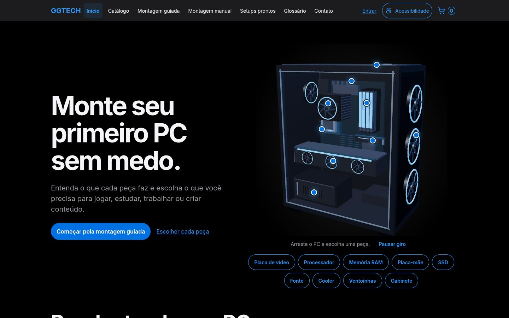

# GGTECH

**Gabriel Guimarães · Desenvolvimento de Interfaces · UniCEUB, 2026**

A ideia do GGTECH é ajudar quem está montando o primeiro PC. Quando ainda se está aprendendo o que cada peça faz, é fácil se perder entre nomes parecidos e preços diferentes. Organizei o site para que dê para explorar o gabinete, comparar modelos e testar se uma combinação de peças funciona antes de comprar.

## Abra as duas entregas

- **Parcial.** O gabinete tem quatro categorias clicáveis, com 20 produtos demonstrativos. Também dá para trocar o tema e navegar pelo carrossel. A cópia vem do commit `5615947`, que corrigiu o contraste, o foco e o ícone da aba depois da primeira publicação. [Entrega parcial](https://gabrielguimaraes07.github.io/Trabalho_final_di/entrega-parcial/) · [Arquivos da parcial](entrega-parcial/)
- **Final.** O catálogo tem 62 produtos reais em 19 categorias e 16 setups. Entraram a montagem guiada, a montagem manual, a comparação, o guia, o glossário, o carrinho e o painel de acessibilidade. [Entrega final](https://gabrielguimaraes07.github.io/Trabalho_final_di/entrega-final/) · [Arquivos da final](entrega-final/)



[Catálogo](entrega-final/docs/prints/apresentacao-catalogo.jpg) · [Montagem guiada](entrega-final/docs/prints/apresentacao-montador.jpg) · [Montagem manual](entrega-final/docs/prints/apresentacao-simulador.jpg) · [Início no celular](entrega-final/docs/prints/apresentacao-celular.jpg) · [Painel de acessibilidade](entrega-final/docs/prints/apresentacao-acessibilidade.jpg)

## Como o site foi construído

### 1. A base da página

A primeira página ganhou cabeçalho, menu, conteúdo principal e rodapé em HTML. O link **Pular para o conteúdo** ajuda quem navega com Tab a chegar direto à parte útil. No CSS, reuni cores, tamanhos de fonte, espaçamentos e cantos dos cartões no mesmo arquivo. Assim a página inicial e as telas que vieram depois podiam usar a mesma paleta. [Paleta](entrega-final/docs/paleta.md)

### 2. O gabinete virou o ponto de partida

O gabinete foi montado no Three.js com formas, materiais e luzes. Na parcial, dava para girar o modelo e escolher processador, placa de vídeo, memória ou fonte. Cada ponto clicável abria uma gaveta da categoria. Ela lê o JSON e mostra os produtos de exemplo.

Coloquei botões com os nomes das peças abaixo do gabinete para dar acesso às mesmas opções pelo teclado. Quando o WebGL não abre, aparece uma imagem de reserva. Na final, a vista explodida passou a mostrar onde cada componente fica.

### 3. A primeira entrega ganhou exemplos

Os cartões explicam as peças com analogias do dia a dia. A RAM, por exemplo, é comparada à mesa de trabalho. O carrossel mostra ambientes de referência e tem setas, indicadores e pausa. A escolha do tema fica guardada no navegador. A revisão da parcial também ajustou a barra translúcida e a posição dos controles que ficavam atrás do menu ao navegar pelo teclado. [Revisão da parcial](entrega-final/docs/revisao-parcial.md)

### 4. Organizei as telas e as opções de leitura

Na final, o menu ganhou caminhos para catálogo, montagens, setups, glossário e contato. No celular, os links ficam dentro de um menu expansível. Os nomes e a ordem dos links se repetem nas páginas, e o item atual é indicado pelo azul.

No painel de acessibilidade, dá para mudar o tema, o tamanho e o espaçamento do texto, aumentar o contraste, sublinhar links ou usar a fonte Atkinson Hyperlegible. A prévia mostra o resultado na hora. A opção de reduzir movimento pausa a rotação automática e as trocas do carrossel. [Escolhas de interface](entrega-final/docs/ihc-ux-ui.md)

### 5. Os produtos de exemplo deram lugar a modelos reais

Cada peça da final tem um `id` usado no catálogo, no guia, no carrinho e nas montagens salvas. A ficha reúne nome, marca, especificações, preço, data e origem da cotação. As fotos ficam no projeto, o que ajuda na apresentação local.

A ampliação mais recente trouxe três gabinetes aquário — MSI MAG PANO M100R PZ White, NZXT H6 Flow Black e Corsair 3500X ARGB White — e três headsets — Razer BlackShark V2 X, Logitech G432 e HyperX Cloud III Wireless. No guia, é possível consultar as portas, os acessórios e os limites de montagem informados para cada modelo. [Fotos, fichas e cotações](entrega-final/docs/fontes-apresentacao.md#gabinetes-aquário-e-headsets)

### 6. A busca e a comparação ficaram no catálogo

A busca e a categoria ficam à vista. Marca, preço e compatibilidade ficam entre os filtros adicionais. Em cada cartão, nome, foto e preço aparecem junto da opção de levar a peça à montagem. **Detalhes da peça** abre as informações que não cabem na ficha resumida.

Dá para comparar até três modelos do mesmo tipo. A barra mantém as escolhas à mão enquanto se navega, e o quadro alinha informações equivalentes. Numa comparação de processadores, por exemplo, há uma linha para conferir o vídeo integrado de todos eles. [Heurísticas de Nielsen no GGTECH](entrega-final/docs/heuristicas-nielsen.md)

### 7. Fiz dois caminhos para montar o PC

Na **montagem guiada**, são três perguntas. A pessoa escolhe o uso do PC, informa o orçamento e decide o que importa mais entre economia, desempenho e iluminação RGB. Se o limite fica abaixo dos setups do catálogo, o aviso já aparece na pergunta de orçamento. O resultado separa as peças do computador, os periféricos e seus subtotais.

Na **montagem manual**, dá para começar do zero ou editar um dos setups prontos. A lista de peças, o total e os alertas acompanham as escolhas. Um processador com vídeo integrado pode atender à etapa de saída de vídeo. A montagem pode ser salva, compartilhada por link ou impressa.

### 8. A escolha de peças chegou à revisão da compra

A checagem cruza socket, memória, formato da placa-mãe, espaço para GPU e cooler, radiadores, baias, alimentação e conexão de vídeo. Um caso é o MSI MAG PANO M100R PZ. Ele tem uma baia compartilhada, então a combinação de SSDs SATA e HDs precisa caber no número real de suportes.

O carrinho mostra as peças escolhidas, suas quantidades e o total antes da compra simulada. Confirmações ajudam a evitar que a pessoa substitua uma montagem sem querer. No celular, a barra com o total leva direto ao resumo.

### 9. Revisei o que mais importa ao apresentar o projeto

As verificações cobrem navegação por teclado, contraste, telas largas e estreitas, importação de setups, comparação, carrinho e salvamento. Foram conferidas também a ampliação do texto a 200% e a imagem de reserva do gabinete. A auditoria informa qual versão foi testada e o que ainda falta conferir, como o uso em aparelhos Apple. [Testes do projeto](entrega-final/docs/auditoria.md) · [Registro de uso de IA](entrega-final/docs/registro-ia.md)

## Um exemplo para mostrar na apresentação

1. Abra **Montagem guiada** e escolha **Estudar**.
2. Digite R$ 4.000 para ver o aviso de orçamento. Depois, ajuste para R$ 8.500.
3. Compare os subtotais e use **Personalizar na montagem manual** para escolher outro gabinete ou headset.
4. Confira o novo total e os alertas. Leve a configuração ao carrinho e revise os itens antes de confirmar a simulação.

## Como rodar no seu computador

Abra no VS Code o `index.html` da versão que quiser testar e use **Open with Live Server**. Se preferir usar Python, abra o terminal na raiz do repositório e rode o comando abaixo.

```sh
python -m http.server 8765
```

Depois, abra `http://localhost:8765/entrega-parcial/` ou `http://localhost:8765/entrega-final/`. O servidor local permite que o navegador carregue os arquivos JSON e os módulos. Na parcial, o Three.js é carregado pela internet. Na final, a biblioteca vem com os arquivos do projeto.

## Onde mexer no código

- **HTML** define a página e os controles. Dentro da final, `index.html` é o início, `estoque.html` abre o catálogo e `simulador.html` abre a montagem manual.
- **CSS** fica em `css/`. `tokens.css` guarda a paleta e `layout.css` cuida do menu e do rodapé. Há estilos separados para o catálogo, a montagem e a acessibilidade.
- **JavaScript** fica em `js/`. `main.js` inicia as páginas e `compatibilidade.js` reúne as regras de encaixe e conexão.
- **JSON** fica em `data/`. `produtos.json` guarda as fichas, `builds.json` tem os setups e `glossario.json` traz as definições.
- **Mídia e bibliotecas** ficam em `assets/`. Three.js desenha o gabinete, e GSAP controla as animações, como a separação das peças. [Mapa do código](entrega-final/docs/codigo.md)

## Limites da demonstração

Os preços são referências em reais e sem frete. Cotações históricas vêm de anúncios indisponíveis ou encerrados. A checagem considera as medidas e conexões cadastradas. BIOS, folga para cabos e posição do radiador ainda dependem da montagem física. O login, o contato e a compra são simulados. O carrinho, as preferências e as montagens salvas ficam no navegador usado.

As origens das fotos, a fonte de leitura e as licenças das bibliotecas estão nas referências. [Créditos e licenças](entrega-final/docs/referencias.md)
