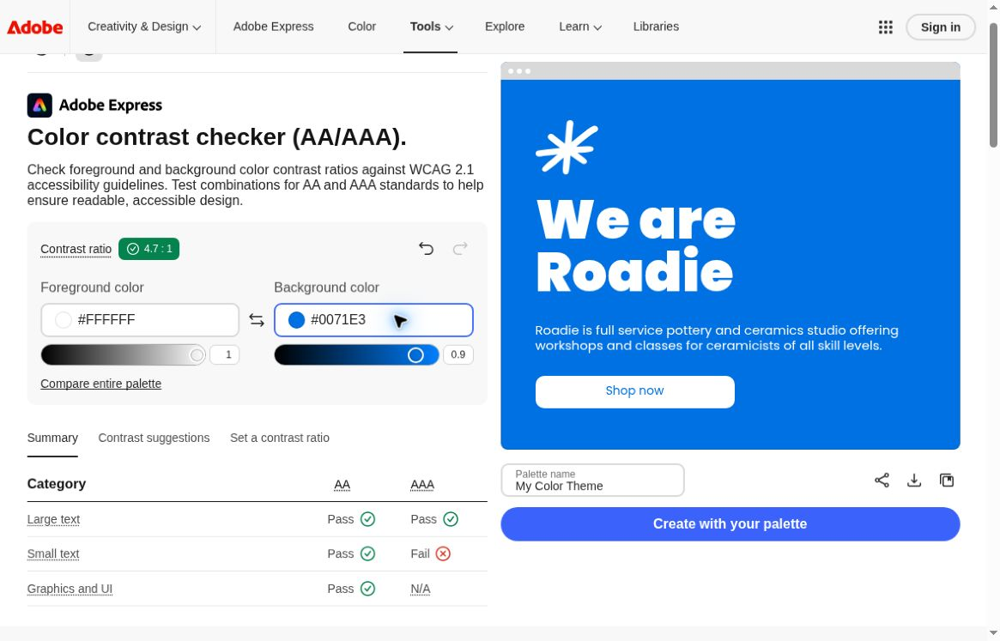

# Testes de contraste no Adobe Color

Em 24/11/2026, o verificador de contraste do Adobe Color, que aparece com a marca Adobe Express, foi usado para medir 15 pares de cores da entrega final. Para cada par, o primeiro código é a cor do texto, do botão ou do contorno. O segundo é o fundo. [Abrir o verificador da Adobe](https://color.adobe.com/create/color-contrast-analyzer)

O mínimo no nível AA é **4,5:1 para texto comum** e **3:1 para texto grande**. O limite de **3:1** também vale para as partes visuais necessárias para identificar um controle ou seu estado. O verificador cita a WCAG 2.1. Esses limites são os mesmos na WCAG 2.2. [Contraste de texto](https://www.w3.org/WAI/WCAG22/Understanding/contrast-minimum.html) · [Contraste de elementos visuais](https://www.w3.org/WAI/WCAG22/Understanding/non-text-contrast.html)

Para testar a transparência, a camada escura de 96% foi composta sobre branco e a clara sobre preto. O resultado foi arredondado para um código hexadecimal antes de entrar na Adobe. Isso explica as pequenas diferenças em relação ao cálculo do projeto, que usa os canais sem arredondar. O item ativo do menu tem um fundo próprio, feito com 10% do azul de destaque sobre a cor do cartão. [Cálculo com as cores do CSS](wcag-contraste.md)

## Tema escuro

- **Texto principal.** `#F5F5F7` sobre `#262628` deu **13,87:1**.
- **Texto secundário.** `#98989E` sobre `#262628` deu **5,27:1**.
- **Links e contorno de foco.** `#2997FF` sobre `#262628` deu **5,01:1**.
- **Mensagens de confirmação.** `#30D158` sobre `#262628` deu **7,47:1**.
- **Mensagens de erro.** `#FF5D52` sobre `#262628` deu **4,99:1**.
- **Limite azul do botão sobre o fundo translúcido.** `#0071E3` sobre `#262628` deu **3,22:1**.
- **Item atual do menu.** `#2997FF` sobre `#1E2935` deu **4,89:1**.

## Tema claro

- **Texto principal.** `#1D1D1F` sobre `#F5F5F5` deu **15,44:1**.
- **Texto secundário.** `#606067` sobre `#F5F5F5` deu **5,72:1**.
- **Links e contorno de foco.** `#005BB5` sobre `#F5F5F5` deu **6,09:1**.
- **Mensagens de confirmação.** `#176E32` sobre `#F5F5F5` deu **5,81:1**.
- **Mensagens de erro.** `#B52825` sobre `#F5F5F5` deu **5,85:1**.
- **Limite azul do botão sobre o fundo translúcido.** `#0071E3` sobre `#F5F5F5` deu **4,31:1**.
- **Item atual do menu.** `#005BB5` sobre `#E6EFF8` deu **5,71:1**.

## Botão principal nos dois temas

O texto branco (`#FFFFFF`) sobre o azul do botão (`#0071E3`) deu **4,70:1**. Na Adobe, passou em AA para texto comum. O fundo azul do botão em relação à superfície passou no mínimo de 3:1 nos dois temas. As 15 combinações passaram em AA para os usos descritos acima.

Para repetir qualquer medição, entre no verificador, abra os seletores de cor e digite os códigos em HEX. Use **Foreground color** para a primeira cor e **Background color** para a segunda. O resultado aparece em **Contrast ratio** e a classificação, na aba **Summary**. Para ver a conferência dos controles nas páginas, consulte os testes do projeto. [Abrir o verificador](https://color.adobe.com/create/color-contrast-analyzer) · [Testes do GGTECH](auditoria.md)
